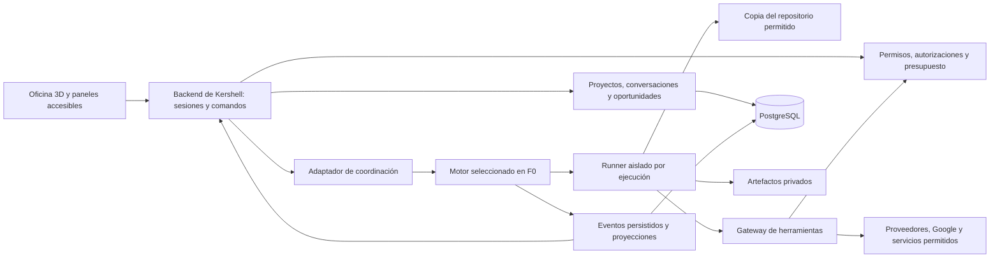

# Arquitectura propuesta

Estado: propuesta de implementación, pendiente del gate de Fase 0. Fecha: 2026-10-11. Las decisiones de producto y autoridad están fijadas en [ADR-001](decisions/001-product-and-authority.md); motor y runtime se resuelven con evidencia en [ADR-002](decisions/002-orchestration-and-runtime.md).

## Diseño general



La interfaz no inicia procesos directamente ni contiene credenciales de proveedores. El backend recibe comandos, verifica autoridad y admite trabajos. Un runner procesa los trabajos fuera de la vida de una petición HTTP. Los resultados y eventos se conservan aunque se cierre el navegador.

## Base tecnológica para evaluar

| Pieza | Propuesta y motivo | Decisión en F0 |
|---|---|---|
| Web | React + TypeScript + Vite; aplicación interna con API separada y sin necesidad inicial de SEO | Confirmar frente a stack ya reutilizable |
| 3D | Three.js mediante React Three Fiber, geometría simple y controles DOM | Probar selección, carga y rendimiento con versiones compatibles |
| Backend y worker | Node.js + TypeScript; módulos separados y contratos comunes | Elegir librería HTTP, validación y runner según motor |
| Persistencia | PostgreSQL, migraciones versionadas, artefactos fuera de tablas | Encaje con Paperclip y propiedad de cada tabla |
| Tiempo real | SSE desde backend y comandos HTTP | Confirmar eventos/reconexión del motor; no abrir App Server al navegador |
| Coordinación | Paperclip por API o un motor mínimo propio | Prueba comparable antes de seleccionar |
| IA/código | Codex vía adaptador de runtime; App Server stdio o SDK según capacidades probadas | Autenticación, aprobación, interrupción y recuperación |
| Investigación | Adaptador de búsqueda con fuentes y proveedor de modelo | Cuotas, citas y costes medidos |
| Entorno | Contenedores/VM con separación entre control y ejecución | Medir recursos y controles efectivos |

No se fija una versión de memoria. F0 registra versiones, licencias, esquemas y compatibilidad; F1 instala versiones exactas con archivo de bloqueo. Redis, Kubernetes, bases vectoriales y buses externos se añaden sólo si una necesidad medida los justifica.

## Reutilizar o construir

**Si se adopta Paperclip:** su motor es la autoridad de tareas, asignaciones y ejecuciones. Kershell guarda conversaciones, oportunidades, políticas propias, identificadores de integración y proyecciones para la oficina. Usa una sola programación operativa y sincroniza por eventos o polling con cursor cuando no haya stream suficiente. No escribe directamente en tablas internas de Paperclip. Sus límites y aprobaciones deben pasar los mismos escenarios que el motor propio.

**Si se elige motor propio:** las tablas de tareas, ejecuciones, leases, aprobaciones y agenda viven en el backend de Kershell. Un worker consulta trabajos elegibles con bloqueo transaccional, lease y fencing token; el scheduler crea trabajos persistentes. La cola inicial puede ser PostgreSQL sin otro servicio.

En ambos modos la política de acciones externas y la concesión de credenciales se aplica en un único gateway de Kershell. La autorización de un efecto externo vive en ese gateway; el motor refleja su resultado. No se crean dos fuentes independientes para aprobar la misma acción. El spike debe demostrar que el motor elegido no permite un camino lateral que evite el gateway.

El adaptador es una frontera pequeña, con una sola implementación activa. No se mantienen dos motores completos como plan de contingencia.

## Estructura prevista tras F1

```text
apps/web/                  oficina, paneles, configuración
apps/api/                  sesiones, comandos, consultas, SSE
apps/worker/               coordinación, programación, recuperación
packages/contracts/       esquemas compartidos y eventos versionados
packages/orchestrator/    adaptador del motor seleccionado
packages/runtime/         runner y adaptador Codex
packages/policy/          permisos, presupuestos y efectos autorizados
packages/integrations/    proveedores, GitHub, Google y servidores
packages/office-scene/    escena y componentes de selección
tests/e2e/                recorridos completos sobre fixtures aislados
infra/                    despliegue y restauración sin secretos
docs/                     especificación y decisiones
tasks/                    plan y tareas
.agents/skills/            procedimientos del equipo constructor
.codex/                   perfiles y configuración verificadas
```

Esta es la organización prevista, no carpetas de código ya implementadas. Si Paperclip resuelve un módulo, se incorpora su adaptación en lugar de duplicarlo.

## Entidades y autoridad

| Entidad | Campos mínimos y regla |
|---|---|
| CompanyProfile | Capacidades, inventario, restricciones, versión y confirmación humana |
| Project | ID, repositorios permitidos, rama base, docs, comandos verificados, propietario |
| Team / AgentProfile | Misión, herramientas, ámbitos, estado, presupuesto y revisor |
| Conversation / Message | Equipo, proyecto, autor, contenido, intención y tarea relacionada |
| Task | Objetivo, alcance, criterios, dueño, proyecto, dependencias, presupuesto y versión |
| Run | Tarea, intento, runner, runtimeThreadId, lease, fencing token, paso y uso |
| ActionIntent / Approval | Actor, recurso, operación, hash de contenido/destino, caducidad y decisión |
| Artifact / Review | Ruta privada, hash, ejecución, revisión, comprobaciones y resultado |
| Integration / SecretRef | Identidad, capacidades, estado y referencia; nunca valor secreto en consulta |
| Schedule | Rutina, zona horaria, horario local, enabled, próxima ejecución y política de retraso |
| Opportunity / Evidence | Problema, comprador, encaje, hipótesis, fuentes, fechas y decisiones |
| UsageReservation / Ledger | Límite, reserva, uso observado, estimado/confirmado y reconciliación |
| AuditEvent / Outbox | Actor, acción, ámbito, resultado, secuencia y entrega pendiente |

Cada registro con contenido de proyecto tiene ámbito explícito. Un agente sólo recibe la intersección de permisos de rol, tarea, proyecto y conexión. Dirección puede leer resúmenes cruzados autorizados; no obtiene automáticamente documentos o secretos de todos los proyectos.

## Estados de tarea y ejecución

```text
DRAFT → QUEUED → RUNNING → REVIEW_READY → COMPLETED
                 ↕
       WAITING_INPUT / WAITING_APPROVAL / BLOCKED / PAUSED
                 ↓
           FAILED / CANCELLED
```

`REVIEW_READY` exige artefactos y verificaciones; `COMPLETED` exige la aceptación prevista para ese tipo de tarea, humana cuando corresponda. Una tarea de código no se cierra por una frase del agente. Los resultados parciales se conservan en fallo y cancelación.

Cada cambio de estado especifica quién puede solicitarlo y qué lo confirma. Pausa y cancelación comienzan como comandos pendientes, no como un estado final ficticio. El runner confirma que no sigue escribiendo antes de anunciar «Pausado» o «Cancelado». Una pausa puede esperar un punto seguro; se informa el plazo y se ofrece interrupción. Si un runtime no reanuda exactamente, se inicia otro intento desde artefactos seguros, con trazabilidad y sin repetir efectos externos.

## Contratos iniciales de módulos

Los esquemas finales se escriben en `packages/contracts` antes del consumo por otros módulos. Entradas, salidas, capacidades y errores se prueban contra la versión fijada del proveedor.

| Interfaz | Operaciones requeridas |
|---|---|
| OrchestratorAdapter | admitTask, enqueue, getTask, listEvents(cursor), requestControl, reconcileRun |
| AgentRuntimeAdapter | capabilities, start, resume si disponible, interrupt, getStatus, streamItems, readUsage |
| ToolGateway | authorizeAction, requestApproval, executeAuthorizedAction, reconcileEffect |
| ArtifactStore | put, getAuthorized, verifyHash, expire |
| SecretStore | write, resolveForAllowedRuntime, rotate, revoke; sin lectura de valor desde UI |
| ResearchProvider | search(query, limits), fetchEvidence, reportUsage; fuentes como datos no confiables |

El runtime anuncia si admite pausa, reanudación, aprobación e informe de uso. La UI sólo ofrece lo que puede cumplir el sistema; la cancelación segura es requisito de aceptación del runner.

## API de producto propuesta

| Recurso | Contrato de entrada y salida |
|---|---|
| `GET /api/teams` | Devuelve equipos, capacidad efectiva, resumen y última actualización |
| `POST /api/conversations/{id}/messages` | Texto, projectId y clientMessageId → messageId, intención y taskId si aplica |
| `GET /api/tasks/{id}` | Objetivo, estado real, progreso cualitativo, entregas y acciones permitidas |
| `POST /api/tasks/{id}/controls` | Tipo pause/resume/cancel/reprioritize, expectedVersion → commandId y estado pendiente |
| `POST /api/approvals/{id}/decisions` | Decisión, expectedVersion, actionHash → resultado o conflicto |
| `POST /api/opportunities/{id}/decisions` | Decisión y alcance/budget/criterios cuando proceda → decisión registrada y taskId único |
| `POST /api/integrations` | Tipo, identidad y configuración permitida → ID y estado; secretos en canal de escritura específico |
| `PATCH /api/schedules/{id}` | Enabled, zona, horario y límites → siguiente slot efectivo |
| `GET /api/events?after=cursor` | Stream autenticado de eventos permitidos con cursor recuperable |

Listados paginados por cursor, tamaños acotados y filtros por proyecto/equipo. Las mutaciones llevan clave de idempotencia y versión cuando compiten. Error común: `{error:{code,message,requestId}}`, con 401 sesión, 403 permisos, 409 conflicto, 422 entrada inválida y 503 dependencia no disponible. No se devuelven stack traces o secretos.

Evento mínimo: `eventId`, `schemaVersion`, `sequence`, `occurredAt`, `projectId`, `taskId`, `runId`, `type`, `payload` validado. El backend publica snapshots y cursores; la UI deduplica y vuelve a consultar snapshot si perdió el tramo retenido. El stream no es la única fuente de estado.

## Ejecución durable e idempotencia

1. La admisión valida alcance y reserva presupuesto de forma atómica con la tarea y evento de salida.
2. El worker reclama un trabajo mediante lease renovable. Un fencing token impide que un worker obsoleto confirme nuevas escrituras de control.
3. Crea un checkout/worktree exclusivo ligado a projectId, repo, commit base y runId. Nunca comparte checkout mutable entre agentes.
4. Persiste IDs de runtime, eventos y artefactos, y publica una proyección legible. La pérdida del stream dispara reconciliación, no una segunda ejecución inmediata.
5. Al vencer el lease, recupera el estado real del runtime antes de reintentar. Un intento nuevo tiene ID propio y conserva la relación con el anterior.
6. Los efectos externos se identifican por actionId y contenido. Un timeout posterior al envío produce estado `UNKNOWN`; se consulta al destino o se pide reconciliación humana antes de repetir.

La entrega de eventos puede ser al menos una vez. No se promete «exactamente una vez» en una API externa que no lo garantice. Las pruebas simulan desconexión antes y después de aceptar una acción y comprueban ausencia de repetición automática insegura.

## Aislamiento y permisos efectivos

Separar plano de control, ejecutores y producción. Los runners usan identidad de sistema y filesystem propios, límites de CPU/RAM/disco/procesos/tiempo, red autorizada y checkout permitido. No reciben root del servidor, socket Docker, credenciales SSH de producción ni secretos de otros proyectos.

Los tokens de escritura externos se mantienen en un broker/gateway fuera del proceso que ejecuta comandos del repositorio. El mecanismo de autenticación de Codex se verifica en F0 para evitar que herramientas de shell hereden credenciales indebidamente. Un contenedor y un prompt por sí solos no cierran ese riesgo. Si el runner no puede demostrar ese límite, no se habilita para trabajo real.

No publicar el transporte del runtime directamente. Autenticación humana, red privada y TLS protegen la interfaz; la identidad del runner se limita a su trabajo. El repo de la oficina es controlado igual que los demás: sus agentes no se conceden a sí mismos permisos o presupuesto.

## Memoria y contexto

El contexto se compone desde perfil de empresa versionado, proyecto, tarea, decisiones vigentes y artefactos relevantes. Tiene procedencia y fecha. Se separan memoria de equipo, de proyecto y resumen global autorizado; ninguna memoria otorga permisos.

Correcciones humanas prevalecen sobre inferencias. Emails, páginas web y documentación de repositorios son datos que pueden contener instrucciones hostiles; el gateway sólo acepta autoridad desde la sesión y las políticas registradas.

Reducir permisos cambia la versión del ámbito de contexto e invalida cachés y resúmenes afectados. Un thread que ya recibió material revocado no se reanuda: se reconstruye otro desde información permitida y se registra la sustitución. No se puede retirar lo ya procesado por el proveedor; la política controla nuevas ejecuciones y aplica su retención/eliminación compatible.
