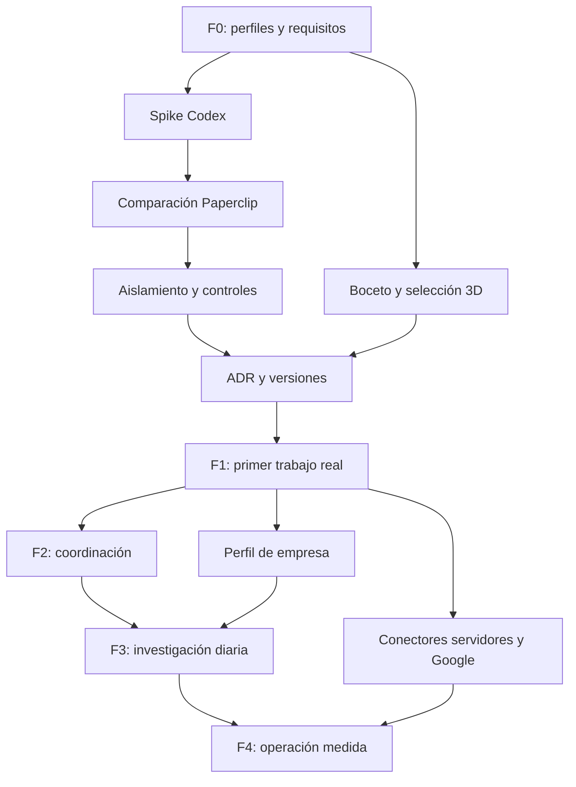

# Plan de desarrollo — Kershell Office

Fecha: 2026-10-11. Estado: propuesta lista para revisión y ejecución por fases. Entrega actual: documentación fundacional; no acredita integración ni software operativo.

## Resultado buscado

Una oficina interna 3D donde Juan selecciona equipos, conversa con ellos, delega trabajos sobre proyectos conectados y revisa resultados reales. Un proceso diario activable investiga oportunidades, las evalúa y espera una decisión humana antes de desarrollar. Configuración concentra proveedores, repos, servidores, Google Workspace, permisos y consumo.

La fuente y su cobertura verificable están en [contexto](../docs/context.md). El plan conserva la oficina 3D y la simplicidad solicitadas. Propone decisiones técnicas que deben verificarse antes de adoptarse.

## Cómo usar este plan

Leer [producto](../docs/product.md), [agentes](../docs/agents.md) y [arquitectura](../docs/architecture.md). Elegir una tarea preparada de [todo.md](todo.md), completar sus dependencias y aportar su evidencia. Las tareas no están cerradas por existir en este documento.

Principal Engineer dirige arquitectura e integración. Product Lead cuida alcance y experiencia. QA y Security/DevOps revisan los controles. Juan valida la utilidad y decide presupuesto, accesos y acciones empresariales. Las decisiones rutinarias dentro del trabajo autorizado no se convierten en nuevas solicitudes de permiso.

## Qué queda definido y qué se decide después

| Base del plan | Decisión técnica pendiente |
|---|---|
| Oficina 3D, conversación y resultados por equipo | Librería y composición visual verificadas |
| Trabajo real con persistencia y control | Paperclip o coordinador mínimo propio |
| Principal Engineer, especialistas y revisión | Perfiles/modelos soportados por la instalación |
| Conexión de Codex | SDK/App Server/API; autenticación y facturación probadas |
| Configuración obligatoria | Backend de secretos y conectores concretos |
| Investigación diaria aprobable | Proveedor de búsqueda, horario y cuotas |
| Control sobre repos y servicios | Inventario, recursos y permisos autorizados |

Los [ADR](../docs/decisions/README.md) documentan motivos, alternativas y evidencia. Paperclip es candidato, no dependencia aceptada. El acceso a Google no depende de que funcionen conectores de terceros si las APIs oficiales ofrecen un camino compatible.

## Fase 0 — Fundamentos y riesgos principales

**Objetivo:** cerrar una arquitectura mínima y reproducible con pruebas pequeñas de las piezas de mayor riesgo.

**Tareas:** F0-01 a F0-06. Preparar perfiles y skills del equipo constructor; verificar Codex, autenticación y uso; comparar Paperclip; demostrar aislamiento y control; definir la dirección visual y registrar la selección de tecnología y recursos.

**Entregables:** harness validado; catálogo de roles; informes de spikes con versiones y resultados; diseño de estados/paneles; ADR de motor/runtime/auth; propuesta de despliegue y presupuesto de piloto.

**Demostración de cierre G0:** una tarea de fixture recorre el runtime, produce artefacto, puede interrumpirse y recuperarse; un acceso fuera de ámbito falla. Se entiende qué piezas se reutilizan y quién es la autoridad de cada dato. La cuenta y costes no se deducen de estar en Work.

Si falta acceso a una cuenta, se puede diseñar y simular, pero el gate de ejecución real queda pendiente. No se construyen dos motores completos durante el spike.

## Fase 1 — Una tarea real desde la oficina

**Objetivo:** validar utilidad de principio a fin para un proyecto piloto.

**Tareas:** F1-01 a F1-14. Base web/API/worker; sesión de propietario; configuración de proveedor y repositorio; conversación y cola; permisos y presupuesto; runner; eventos y recuperación; aprobaciones; pausa/cancelación; artefactos; oficina 3D; bandeja de pendientes; evaluación conjunta.

**Entregables:** aplicación mínima operativa, un equipo de desarrollo y revisión, configuración accesible, un proyecto conectado, estados reales y una entrega con diff y comprobaciones. Los demás equipos aparecen «Sin configurar» cuando corresponda.

**Demostración de cierre G1:** Juan pide un cambio acotado en un repositorio de prueba o copia autorizada. El equipo trabaja con la pestaña cerrada. Juan vuelve, consulta sin generar cambios, ve qué se hizo y revisa evidencia. Se prueban pausa/cancelación, fallo de conexión y reinicio sin doble ejecución. No se publica ni despliega como efecto del ejemplo.

**Aceptación de utilidad:** Juan puede encontrar equipo, trabajo e historial y hacer el pedido sin instrucción técnica. Se registra tiempo/intervención/consumo frente a una tarea equivalente con Codex directo. Si añade más gestión sin beneficio observable, se simplifica antes de ampliar departamentos.

## Fase 2 — Coordinación y contexto de varios equipos

**Objetivo:** delegación selectiva sin que Juan copie instrucciones entre mesas.

**Tareas:** F2-01 a F2-05. Activación de perfiles; coordinador y dependencias; revisión separada y escrituras coordinadas; memoria versionada y recuperación; una demostración entre departamentos.

**Entregables:** dirección puede repartir un objetivo entre producto, desarrollo y marketing según alcance. Cada equipo muestra su parte y la respuesta global es coherente. Las subtareas comparten techo de presupuesto y no escapan del proyecto.

**Demostración de cierre G2:** preparar una propuesta de lanzamiento de un producto piloto, con documento de producto, cambio o demo si procede y borrador de comunicación. QA detecta un defecto sembrado; se corrige antes de aceptar. Reiniciar un worker y lanzar dos reclamaciones no duplica trabajo ni comparte checkout mutable. Los borradores no se envían como efecto del ejemplo.

## Fase 3 — Investigación diaria de oportunidades

**Objetivo:** propuestas comerciales fundamentadas, ligadas a las capacidades reales de Kershell.

**Tareas:** F3-01 a F3-06. Perfil de empresa; agenda persistente; búsqueda y evidencias; evaluación especializada; ficha y cuatro decisiones; digest y consumo.

**Entregables:** activación/pausa/horario en Configuración, historial, deduplicación y bandeja de oportunidades. Exploración acotada y análisis profundo sólo de candidatos prometedores. Prioridad propuesta: vender lo existente, adaptar y después construir nuevo, sin excluir una oportunidad bien respaldada.

**Demostración de cierre G3:** ejecutar una investigación real acotada y casos controlados con noticia repetida, evidencia contradictoria y fallo de proveedor. Distinguir «sin oportunidades» de «no se pudo completar». Aprobar una oportunidad crea una sola tarea con alcance, presupuesto y aceptación. Rechazar o seguir investigando no inicia desarrollo. La rutina opera sin navegador y resiste horario de verano y reinicio.

## Fase 4 — Operación cotidiana e integraciones completas

**Objetivo:** varios proyectos y departamentos con administración y recuperación sostenibles.

**Tareas:** F4-01 a F4-07. Inventario de servidores y comprobaciones de lectura; OAuth Google; lectura autorizada de Workspace; escrituras aprobadas; backup/restauración; mejora 3D y capacidades de marketing/ventas; piloto de varios proyectos.

**Entregables:** conexiones probadas, estados/errores claros, Google Workspace con cuenta efectiva confirmada, historial de acciones, restauración ensayada y consumo visible por proyecto. Las publicaciones, envíos y despliegues respetan autoridad registrada.

**Demostración de cierre G4:** revocar una conexión y verificar bloqueo; restaurar en instancia vacía sin repetir efectos; completar un recorrido Google sobre datos de prueba; operar varios proyectos sin mezcla de contexto. Juan encuentra conexiones, pendientes y resultados de cada equipo. Se mide carga y coste antes de aumentar concurrencia.

La migración de los seis productos a un servidor será un proyecto administrable desde la oficina, con inventario y plan propios. Esta fase no la ejecuta automáticamente.

## Dependencias y trabajo paralelo

Bocetos, definición de perfiles y fichas de datos pueden avanzar en paralelo. Tras fijar contratos, web y API pueden trabajar con fixtures comunes. Migraciones, decisiones compartidas, escritura en una rama y pruebas reales con la misma sesión/proveedor se serializan. La programación diaria no se implementa antes de asegurar persistencia y política de consumo.

## Recursos que hacen falta y cuándo

| Momento | Información/recurso necesario | Si todavía falta |
|---|---|---|
| Redacción actual | Chat, repositorio y landing | Disponibles con cobertura registrada |
| F0 | Proyecto piloto, modalidad Codex disponible, techo de prueba, características generales del servidor | Preparar fixtures y marcar pruebas reales pendientes |
| F1 | Cuenta de prueba y acceso mínimo al repo piloto, presupuesto habilitado, entorno aislado | No ejecutar trabajo facturable o sobre datos reales |
| F3 | Perfil de capacidades confirmado, sectores/canales de venta, horario y cuota diaria | Investigar sólo con perfil de prueba, sin automatización real |
| F4 | Inventario privado de servidores, cuenta Google efectiva, proyecto OAuth y acciones permitidas | Conector no habilitado; no bloquea otras tareas independientes |

Los secretos se incorporan por el mecanismo seguro de conexión, nunca en el chat ni en archivos públicos. La visibilidad del repo era pública al verificarlo; no se cambió. Los inventarios y datos comerciales privados viven en almacenamiento protegido de la aplicación o documentación privada autorizada.

## Estimación orientativa

| Hito | Jornadas técnicas de foco, estimación inicial |
|---|---|
| F0 | 3–5 |
| F1 | 10–15 |
| F2 | 5–8 |
| F3 | 5–8 |
| F4 | 8–12 |

Total orientativo: 31–48 jornadas de trabajo técnico. No son fechas comprometidas ni tiempo de GPU/agente: incluyen implementación, revisión y pruebas, y suponen un responsable con dedicación sostenida, cuentas disponibles y un piloto de alcance pequeño. F0 debe recalcular según reutilización y resultados; con dedicación parcial se alarga el calendario. No se compra infraestructura ni se fija un presupuesto IA a partir de esta estimación.

## Riesgos y respuesta prevista

| Riesgo | Respuesta y gate |
|---|---|
| Motor externo no encaja o cambia | Versiones fijadas, adaptador pequeño y pruebas antes de adoptar, G0 |
| Permisos escritos sólo en prompts | Gateway y sandbox con pruebas negativas, G0/G1 |
| Estados visuales falsos o datos antiguos | Eventos persistidos, snapshot y aviso de desconexión, G1 |
| Cancelación o reintento duplica efectos | Confirmación real y reconciliación antes de repetir, G1/G2 |
| Organigrama caro y burocrático | Delegación selectiva, techo padre y comparación con uso directo, G2 |
| Investigación produce ideas sin compradores | Fuentes, objeciones y validación comercial distinguida de desarrollo, G3 |
| OAuth/cuenta Google no compatible | Identidad efectiva, permisos mínimos y prueba/revocación, G4 |
| Ahorro de suscripciones se pierde en mantenimiento | Medir coste total y trabajo humano antes de ampliar, G4 |

## Revisión y siguientes pasos

La entrega actual prepara una base revisable para el desarrollo. El siguiente incremento es F0-01 y los spikes de riesgo. No hay tareas de desarrollo marcadas como completas. Cerrar cada gate requiere su informe y la revisión correspondiente; una prueba fallida deja el gate abierto.

Las decisiones técnicas de F0 pueden resolverlas Principal Engineer y revisores dentro del alcance aprobado. Juan interviene cuando se decide presupuesto/acceso, cambia el objetivo o se acepta una experiencia de producto. Se registran las autorizaciones para reutilizarlas mientras sigan vigentes.
